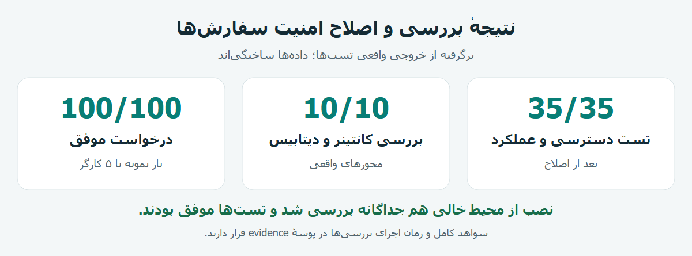
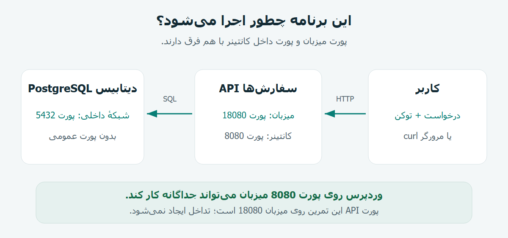
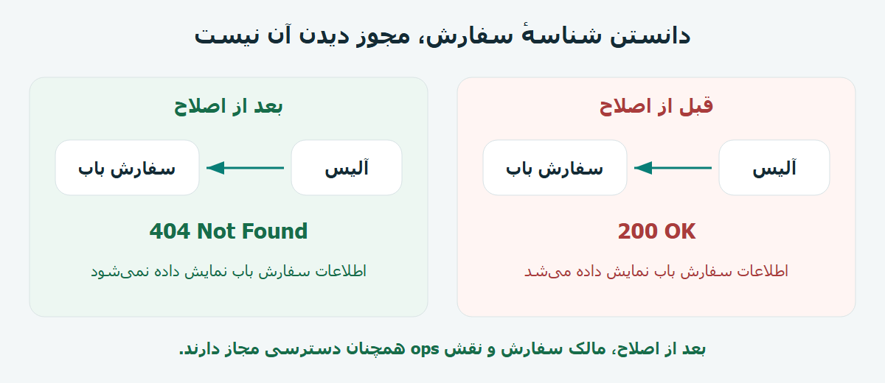
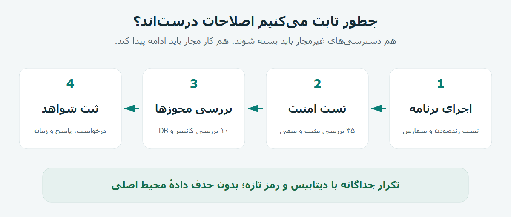

<div dir="rtl">

# Order API Security Assessment

این پروژه یک تمرین امنیتی برای برنامهٔ ثبت سفارش است. نسخهٔ اولیه چند مشکل عمدی داشت: یک کاربر می‌توانست سفارش کاربر دیگر را بخواند، رمز دیتابیس در پاسخ API دیده می‌شد و بخش کنترل برنامه بدون مجوز در دسترس بود. این مشکلات بررسی، بازتولید و اصلاح شده‌اند. تست‌ها و خروجی واقعی آن‌ها هم در همین مخزن قرار دارند.

**مسیر پیشنهادی مطالعه:** ابتدا شکل زیر و بخش «مشکل‌ها و اصلاحات» را ببینید؛ سپس برنامه را اجرا کنید و تست‌ها را تکرار کنید. برای خواندن همین راهنما در مرورگر، فایل [راهنمای تصویری](docs/guide.html) را دانلود و باز کنید؛ در GitHub خود این README نمایش داده می‌شود.



## ۱. برنامه چه کاری انجام می‌دهد؟

کاربر یک سفارش ثبت می‌کند و بعد آن را می‌خواند. اطلاعات سفارش‌ها در دیتابیس PostgreSQL ذخیره می‌شود. برنامه صفحهٔ گرافیکی ندارد؛ خروجی آن JSON است، یعنی متن ساختاریافته‌ای مثل `{"ready": true}`.

سه هویت آزمایشی داریم:

| کاربر | توکن آزمایشی | دسترسی مورد انتظار |
|---|---|---|
| Alice یا آلیس | `lab-alice` | ثبت و مشاهدهٔ سفارش خودش |
| Bob یا باب | `lab-bob` | ثبت و مشاهدهٔ سفارش خودش |
| Ops یا مسئول عملیات | `lab-ops` | مشاهدهٔ سفارش‌ها و استفاده از بخش کنترل و پایش |

**توکن** در این تمرین مثل کارت شناسایی است. برنامه از روی آن می‌فهمد درخواست را چه کسی فرستاده است. اما شناختن کاربر کافی نیست؛ باید اجازهٔ دسترسی او به هر سفارش هم بررسی شود.



پورت `18080` مربوط به دسترسی به برنامه روی میزبان است. پورت `8080` داخل کانتینر API است؛ این دو یکی نیستند. پس برنامه می‌تواند کنار یک وردپرس که روی پورت `8080` میزبان است اجرا شود. دیتابیس با پورت `5432` فقط در شبکهٔ داخلی داکر در دسترس است و روی میزبان منتشر نمی‌شود.

## ۲. محدودهٔ بررسی چه بوده است؟

فقط همین آزمایشگاه و داده‌های ساختگی بررسی شده‌اند. اطلاعات مهم این محیط، سفارش‌ها و مالک آن‌ها، رمز دیتابیس و تنظیمات کنترل سرویس هستند. مهاجم احتمالی می‌تواند یک کاربر عادی یا فردی بدون توکن باشد.

سه مرز مهم داریم: درخواست کاربر به API، اتصال API به دیتابیس و دسترسی کانتینر به میزبان. هر مرز باید به اندازهٔ نیاز دسترسی بدهد. هیچ حمله به سرویس دیگر، دریافت دادهٔ واقعی یا تست مختل‌کننده اجرا نشده است.

## ۳. مشکل‌ها و اصلاحات

### مشکل اول ـ مشاهدهٔ سفارش دیگران

**قبل:** آلیس با توکن خودش و شناسهٔ سفارش باب، اطلاعات سفارش باب را می‌گرفت. برنامه فقط معتبر بودن توکن را بررسی می‌کرد و به مالک سفارش کاری نداشت. این مشکل با نام IDOR هم شناخته می‌شود.

**راهکار:** هنگام خواندن سفارش، علاوه بر شناسه، مالک هم در شرط جست‌وجوی دیتابیس بررسی می‌شود. فقط مالک یا `ops` مجاز است. درخواست آلیس برای سفارش باب اکنون `404` می‌گیرد تا حتی وجود آن سفارش برای او تأیید نشود.

**پیاده‌سازی:** در [app.py](lab/app/app.py)، شرط خواندن سفارش از `WHERE id=%s` به شرط زیر تغییر کرده است. مقادیر از طریق پارامتر SQL ارسال می‌شوند، نه با چسباندن متن ورودی به query.

```sql
WHERE id=%s AND (owner=%s OR %s)
```

پارامترها به ترتیب شناسهٔ سفارش، نام کاربر و نتیجهٔ بررسی `actor == 'ops'` هستند. مالک سفارش جدید هم از توکن گرفته می‌شود؛ کاربر نمی‌تواند با فرستادن یک فیلد در بدنه، خودش را مالک دیگری معرفی کند.



### مشکل دوم ـ نمایش رمز دیتابیس

**قبل:** آدرس `/debug/config` بدون توکن، رشتهٔ اتصال دیتابیس را نشان می‌داد. این رشته یا DSN شامل نام کاربری و رمز بود.

**راهکار:** این مسیر فقط برای `ops` باز است و پاسخ آن به اطلاعات بی‌خطر محدود شده است. حتی `ops` هم رمز یا DSN را در پاسخ نمی‌بیند.

**پیاده‌سازی:** در [app.py](lab/app/app.py)، پاسخ تنظیمات فقط `{"mode":"synthetic-lab"}` است. اطلاعات اتصال، متغیرهای محیطی و متن خطاهای داخلی به کاربر برگردانده نمی‌شوند.

### مشکل سوم ـ کنترل برنامه بدون مجوز

**قبل:** هر فردی می‌توانست به `/lab/control` درخواست بفرستد؛ این مسیر می‌تواند تأخیر مصنوعی یا خطای تجاری ایجاد کند.

**راهکار:** توکن معتبر و نقش `ops` هر دو الزامی شدند. مقادیر کنترل هم بررسی می‌شوند؛ مثلاً تأخیر منفی پذیرفته نمی‌شود.

**پیاده‌سازی:** کنترل دسترسی در [app.py](lab/app/app.py) انجام می‌شود. ابزار [control.py](lab/tools/control.py) هم به‌روز شده تا توکن `ops` را بفرستد و بعد از اصلاح همچنان قابل استفاده باشد.

### مشکل چهارم ـ دیده‌شدن اطلاعات URL در آمار و لاگ

**قبل:** مسیر کامل درخواست، همراه پارامترهای بعد از `?`، ذخیره می‌شد و در `/metrics` عمومی دیده می‌شد. اگر اطلاعات حساسی در URL باشد، ممکن است از همین مسیر لو برود. ذخیرهٔ مسیرهای نامحدود و فهرست همهٔ زمان‌های پاسخ، حافظه را هم افزایش می‌داد.

**راهکار:** دسترسی آمار به `ops` محدود شد. در لاگ و آمار فقط نام ثابت مسیر ثبت می‌شود؛ مثلاً `/orders/:id` به‌جای شناسهٔ واقعی. query ثبت نمی‌شود. برای زمان پاسخ فقط مجموع و تعداد نگه‌داری می‌شود.

**پیاده‌سازی:** تابع `route_label` و بخش metrics در [app.py](lab/app/app.py). این مورد با یک marker کاملاً ساختگی در URL، قبل و بعد از اصلاح بررسی شده است.

### مشکل پنجم ـ رمز ثابت و دسترسی زیاد به دیتابیس

**قبل:** رمز در فایل Compose نوشته شده بود و API با نقش راه‌انداز دیتابیس کار می‌کرد. در نتیجه هم رمز داخل سورس وجود داشت و هم دسترسی API بیشتر از نیازش بود.

**راهکار:** برای مدیر DB و برنامه دو رمز تصادفی جدا ساخته می‌شود. رمزها از فایل به کانتینر تزریق می‌شوند. API فقط رمز خودش را می‌گیرد و با کاربر `lab_app` وصل می‌شود؛ این کاربر اجازهٔ خواندن و ثبت سفارش دارد، اما مدیر دیتابیس نیست و نمی‌تواند جدول یا schema بسازد.

**پیاده‌سازی:** [setup_secrets.py](lab/tools/setup_secrets.py)، [init.sh](lab/db/init.sh) و [compose.yaml](lab/compose.yaml). در ارتقای محیط قبلی، رمز اولیهٔ مدیر هم تغییر می‌کند. فایل‌های رمز در Git قرار نمی‌گیرند.

### مشکل ششم ـ اجرای API با دسترسی root

**قبل:** در Dockerfile کاربر مشخص نشده بود؛ برنامه به‌صورت پیش‌فرض با root اجرا می‌شد و فایل‌سیستم کانتینر قابل نوشتن بود. این وضعیت در صورت نفوذ، اثر مشکل را بیشتر می‌کند؛ به‌تنهایی اثبات نفوذ نیست.

**راهکار:** برنامه با کاربر غیر root به شناسهٔ `10001` اجرا می‌شود. فایل‌سیستم اصلی فقط‌خواندنی است؛ قابلیت‌های اضافی لینوکس حذف و افزایش دسترسی ممنوع شده است. برای فایل موقت، فضای محدود جدا وجود دارد.

**پیاده‌سازی:** [Dockerfile](lab/app/Dockerfile) و تنظیمات API در [compose.yaml](lab/compose.yaml). دیتابیس پورت عمومی نداشت؛ این ویژگی حفظ و شبکهٔ داخلی هم اضافه شده است.

## ۴. اجرای برنامه از صفر

نیازمندی‌ها: Docker Compose v2 و Python 3.10 یا بالاتر؛ اینترنت برای دریافت image و dependency. دستورهای این راهنما برای ترمینال لینوکس یا جلسهٔ SSH نوشته شده‌اند. روی ویندوز برای ابزارهای Python می‌توان به‌جای `python3` از `python` استفاده کرد.

پس از clone کردن مخزن، وارد پوشهٔ `lab` شوید:

```bash
git clone https://github.com/AlirezaHossaini79/order-api-security-assessment.git
cd order-api-security-assessment/lab
python3 tools/setup_secrets.py
docker compose -p hr-hosseini up -d --build
python3 tools/smoke.py
```

ابزارهای تست روی میزبان از کتابخانهٔ استاندارد Python استفاده می‌کنند و نصب dependency جداگانه لازم ندارند. در اجرای موفق، دستور آخر این پیام را می‌دهد:

```text
PASS: live, ready, create, read
```

این تست ساده بررسی می‌کند برنامه زنده است، به دیتابیس وصل می‌شود و ثبت و خواندن سفارش کار می‌کند.

### اگر نسخهٔ اولیه از قبل اجرا شده است

اجرای سادهٔ API جدید روی DB قدیمی کافی نیست؛ باید کاربر محدود و مجوزهایش هم ساخته شوند. اسکریپت زیر این کار را با حفظ سفارش‌ها انجام می‌دهد:

```bash
cd /root/direct/lab
sh tools/deploy_existing.sh lab
```

`lab` نام پروژهٔ فعلی سرور است. اگر قبلاً با `-p hr-hosseini` اجرا کرده‌اید، همان نام را جایگزین کنید. این اسکریپت نسخهٔ جدید را می‌سازد، برای مدت کوتاهی API را متوقف می‌کند، تنظیمات DB را اصلاح می‌کند و برنامه را دوباره بالا می‌آورد. volume اصلی حذف نمی‌شود.

## ۵. تنظیم پورت و رمزها

حالت پیش‌فرض فقط از خود میزبان در دسترس است:

```text
http://127.0.0.1:18080/live
```

برای تغییر تنظیمات اختیاری:

```bash
cp .env.example .env
```

فایل `.env` را ویرایش کنید. برای دسترسی با آی‌پی عمومی، `LAB_BIND_ADDRESS=0.0.0.0` و برای تغییر پورت، مثلاً `LAB_PORT=18081` بگذارید؛ سپس دوباره دستور `docker compose -p hr-hosseini up -d` را اجرا کنید. تست‌ها هم باید به پورت انتخاب‌شده فرستاده شوند. این برنامه صفحهٔ اصلی ندارد؛ برای بررسی در مرورگر از `/live` یا `/ready` استفاده کنید.

رمزها در `lab/secrets/` ساخته می‌شوند و مقدارشان چاپ نمی‌شود. اجرای دوبارهٔ ابزار، رمزهای موجود را عوض نمی‌کند. پوشه روی لینوکس با دسترسی `0700` ساخته می‌شود و فایل داخل آن برای خواندن توسط کاربر کانتینر `0644` است. در ویندوز، دسترسی فایل‌ها تابع ACL کاربر است. Compose این فایل‌ها را فقط‌خواندنی mount می‌کند؛ فقط رمز برنامه در اختیار API قرار می‌گیرد. این سازوکار فایل‌محور است و رمزنگاری ذخیره‌سازی یا secret manager ابری ایجاد نمی‌کند.

## ۶. تست دستی با چشم خودمان

همهٔ دستورهای این بخش را در یک ترمینال اجرا کنید. از توکن‌های ساختگی همین تمرین استفاده می‌شود. **نسخهٔ فعلی اصلاح شده است**؛ برای نتیجهٔ قبل، فایل [شواهد نسخهٔ اولیه](evidence/before.json) را ببینید. لازم نیست برنامهٔ ناامن را دوباره روی سرور عمومی اجرا کنید.

### قدم اول ـ آدرس برنامه را مشخص کنید

```bash
BASE=http://127.0.0.1:18080
```

اگر از دستگاه دیگری تست می‌کنید، آدرس و پورت سرور خودتان را جایگزین کنید. از اینجا به بعد، `$BASE` همان آدرس است.

### قدم دوم ـ باب یک سفارش تازه ثبت کند

```bash
curl -i "$BASE/orders" \
  -H 'Authorization: Bearer lab-bob' \
  -H 'Content-Type: application/json' \
  -d '{"item":"BOB-PRIVATE-ORDER"}'
```

انتظار: پاسخ `201` با یک `id` جدید. مقدار ID هر بار ممکن است فرق کند. در دستور بعد، `123` را با عددی که واقعاً گرفته‌اید جایگزین کنید؛ به IDهای اولیه اتکا نکنید.

```bash
ORDER_ID=123
```

### قدم سوم ـ سه هویت همان سفارش را بخوانند

```bash
# مالک: باید 200 بگیرد و سفارش را ببیند
curl -i "$BASE/orders/$ORDER_ID" -H 'Authorization: Bearer lab-bob'

# کاربر دیگر: باید 404 بگیرد و اطلاعات سفارش را نبیند
curl -i "$BASE/orders/$ORDER_ID" -H 'Authorization: Bearer lab-alice'

# مسئول عملیات: باید 200 بگیرد و سفارش را ببیند
curl -i "$BASE/orders/$ORDER_ID" -H 'Authorization: Bearer lab-ops'
```

برای بررسی جهت عکس، همین کار را با سفارش تازهٔ آلیس تکرار کنید؛ باب نباید به آن دسترسی بگیرد. تست خودکار هر دو جهت را بررسی می‌کند.

### قدم چهارم ـ بدون توکن و با توکن اشتباه امتحان کنید

```bash
curl -i "$BASE/orders/$ORDER_ID"
curl -i "$BASE/orders/$ORDER_ID" -H 'Authorization: Bearer invalid-token'
```

انتظار: هر دو `401`. برنامه باید قبل از دادن اطلاعات، هویت معتبر بخواهد.

### قدم پنجم ـ تنظیمات حساس را بررسی کنید

```bash
# بدون توکن: 401
curl -i "$BASE/debug/config"

# آلیس: 403
curl -i "$BASE/debug/config" -H 'Authorization: Bearer lab-alice'

# ops: پاسخ 200، اما فقط mode و بدون DSN یا رمز
curl -i "$BASE/debug/config" -H 'Authorization: Bearer lab-ops'
```

انتظار برای پاسخ مجاز:

```json
{"mode": "synthetic-lab"}
```

### قدم ششم ـ دسترسی بخش کنترل را بررسی کنید

بدنهٔ خالی تنظیمی را تغییر نمی‌دهد، پس برای بررسی مجوز کافی است:

```bash
# بدون توکن: 401
curl -i "$BASE/lab/control" -H 'Content-Type: application/json' -d '{}'

# آلیس: 403
curl -i "$BASE/lab/control" -H 'Content-Type: application/json' \
  -H 'Authorization: Bearer lab-alice' -d '{}'

# ops: 200
curl -i "$BASE/lab/control" -H 'Content-Type: application/json' \
  -H 'Authorization: Bearer lab-ops' -d '{}'
```

### قدم هفتم ـ نبود query در آمار را بررسی کنید

```bash
curl -s "$BASE/live?probe=synthetic-query-marker"
curl -i "$BASE/metrics"
curl -s "$BASE/metrics" -H 'Authorization: Bearer lab-ops'
```

درخواست بدون توکن به metrics باید `401` بگیرد. پاسخ مجاز باید آمار داشته باشد، اما متن `synthetic-query-marker` در آن نباشد. در این تست فقط از یک عبارت ساختگی استفاده کنید.

### معنی کدهای پاسخ

| کد | معنی در این برنامه |
|---|---|
| 200 | درخواست موفق بود؛ در حالت خطای تجاری باید بدنهٔ `ok` را هم بررسی کرد |
| 201 | سفارش ساخته شد |
| 400 | ورودی قابل قبول نیست |
| 401 | توکن غایب یا نامعتبر است |
| 403 | هویت معتبر است، ولی این نقش اجازه ندارد |
| 404 | سفارش وجود ندارد یا کاربر مجاز به دیدن آن نیست |
| 405 | روش HTTP برای این مسیر مناسب نیست |
| 503 | وابستگی مثل دیتابیس در دسترس نیست |

## ۷. تست خودکار و خروجی قابل بررسی



این دستورها را از `lab` اجرا کنید. `security_checks.py` سفارش تازه می‌سازد و ID را از پاسخ می‌گیرد؛ شناسهٔ ثابت ندارد.

```bash
python3 tests/security_checks.py --url http://127.0.0.1:18080 \
  --expect fixed --evidence ../evidence/local-security.json

python3 tools/runtime_checks.py --project hr-hosseini \
  --evidence ../evidence/local-runtime.json
```

انتظار: `35/35 checks passed` در تست امنیتی و ۱۰ پیام `PASS` در بررسی کانتینر و DB. برای محیط فعلی سرور که نام پروژه‌اش `lab` است، در دستور دوم `--project lab` بگذارید.

تست امنیتی، دسترسی مجاز و غیرمجاز را با هم بررسی می‌کند؛ صرفاً بستن همهٔ مسیرها کافی نیست. تست runtime هم تنظیمات واقعی کانتینر و مجوزهای واقعی DB را می‌خواند، نه فقط متن Compose را.

برای اجرای مستقل با volume و رمز تازه:

```bash
python3 tools/verify_clean.py
```

این ابزار یک پروژهٔ موقت با نام تصادفی و پورت آزاد می‌سازد؛ اجرای برنامه، تست امنیتی، مجوزها، ابزار کنترل و ۱۰۰ درخواست نمونه را بررسی می‌کند. در پایان فقط کانتینرها و volume همان پروژهٔ موقت را پاک می‌کند. محیط اصلی دست‌نخورده می‌ماند.

### نتیجه‌ای که ثبت شده است

| بررسی | نتیجه | مدرک |
|---|---|---|
| بازتولید وضعیت اولیه | ۶ بررسی موفق برای اثبات مشکل‌ها | [before.json](evidence/before.json) |
| دسترسی و عملکرد بعد از اصلاح | ۳۵ از ۳۵ موفق | [after.json](evidence/after.json) |
| تنظیمات واقعی کانتینر و DB | ۱۰ از ۱۰ موفق | [runtime.json](evidence/runtime.json) |
| امنیت در نصب کاملاً تازه | ۳۵ از ۳۵ موفق | [clean-security.json](evidence/clean-security.json) |
| مجوزها در نصب کاملاً تازه | ۱۰ از ۱۰ موفق | [clean-runtime.json](evidence/clean-runtime.json) |
| بار نمونه با ۵ worker | ۱۰۰ درخواست از ۱۰۰ موفق | [clean-run.log](evidence/clean-run.log) |

موفق بودن بررسی‌های نسخهٔ اولیه به معنی امن بودن آن نیست؛ یعنی تست توانسته مشکل را بازتولید کند. فایل‌های JSON زمان UTC، فرمان اجرا و نتیجهٔ تک‌تک بررسی‌ها را دارند. هدر Authorization و مقدار DSN پیش از ذخیره پوشانده شده‌اند؛ تصویرهای راهنما جایگزین این شواهد نیستند.

## ۸. فایل‌ها را از کجا دنبال کنیم؟

```text
README.md                    راهنمای اصلی
SUBMISSION.md                خلاصهٔ تحویل مطابق فرم تمرین
TASK.fa.md                   صورت اصلی تمرین
START-HERE.html              نسخهٔ HTML صورت تمرین
PACKAGE.json                 مشخصات بستهٔ اولیه
lab/
  compose.yaml               اتصال سرویس‌ها، پورت، شبکه و secret
  app/app.py                 منطق API و کنترل دسترسی
  app/Dockerfile             ساخت image و کاربر اجرای API
  app/requirements.txt       نسخهٔ dependencyها
  db/init.sh                 ساخت نقش محدود و مجوزهای DB
  tests/security_checks.py   تست مثبت و منفی دسترسی‌ها
  tools/                     ابزار اجرا، کنترل و بررسی محیط
docs/
  guide.html                 همین راهنما برای خواندن در مرورگر
  SECURITY-REPORT.fa.md       گزارش فنی و محل یافته‌های اولیه
  images/                    تصویرهای توضیحی راهنما
evidence/                    خروجی واقعی و پالایش‌شدهٔ تست‌ها
```

ساختار اصلی `lab/app` و `lab/tools` حفظ شده است. فایل‌های اضافه برای رفع دسترسی‌ها، راه‌اندازی DB و اثبات نتیجه هستند؛ قابلیت تازه‌ای به محصول اضافه نشده است. فایل‌های صورت تمرین بدون تغییر حفظ شده‌اند. در تاریخچهٔ Git، نسخهٔ اولیه و اصلاحات در commitهای جدا قابل مقایسه‌اند.

## ۹. توقف و خطاهای معمول

برای توقف بدون حذف سفارش‌ها:

```bash
docker compose -p hr-hosseini down
```

`down -v` داده را هم حذف می‌کند؛ برای توقف روزمره از آن استفاده نکنید.

| چیزی که می‌بینید | علت محتمل و اقدام |
|---|---|
| `Connection refused` | کانتینر آماده نیست یا پورت اشتباه است؛ `docker compose -p hr-hosseini ps` را ببینید |
| `401` در آدرس اصلی `/` | این برنامه صفحهٔ اصلی ندارد؛ برای سلامت از `/live` استفاده کنید |
| `401` یا `403` در مسیر مدیریتی | توکن و نقش را بررسی کنید؛ این پاسخ ممکن است دقیقاً نتیجهٔ درست تست باشد |
| `404` برای سفارش خودتان | ID واقعی پاسخ ساخت سفارش و توکن مالک را دوباره بررسی کنید |
| خطای فایل secret | ابتدا `python3 tools/setup_secrets.py` را اجرا کنید |
| خطای DB بعد از ارتقای نسخه اولیه | از اسکریپت ارتقای محیط قبلی با نام پروژهٔ درست استفاده کنید |
| پورت اشغال است | مقدار `LAB_PORT` در `.env` را عوض کنید و آدرس تست‌ها را هم تغییر دهید |

## ۱۰. چه محدودیت‌هایی باقی مانده است؟

توکن‌ها عمداً ثابت و آزمایشی‌اند. هرکس توکن باب را بداند، می‌تواند خودش را باب معرفی کند؛ اصلاح مالکیت، جای احراز هویت واقعی را نمی‌گیرد. برای production باید توکن دارای انقضا و امکان لغو، مدیریت هویت، TLS و مدیریت مناسب رمز اضافه شود.

نقش DB محدود شده، اما خود API برای اجرای کارش به خواندن سفارش‌ها دسترسی دارد؛ جداسازی کاربران در API انجام می‌شود و RLS در این تمرین اضافه نشده است. سرور HTTP همان سرور سادهٔ اولیه است و rate limit یا تضمین مقابله با DoS اضافه نشده. کنترل خرابی در حافظهٔ هر نمونه باقی می‌ماند. کلید Idempotency ذخیره می‌شود، اما تضمین جلوگیری از سفارش تکراری ندارد؛ این قابلیت جزو معیارهای امنیتی تمرین نبود.

اسکن CVE اجرا نشده و این گزارش ادعای نبود همهٔ آسیب‌پذیری‌های ممکن را ندارد. تفکیک اصلاحات انجام‌شده و ریسک‌های باقی‌مانده در [گزارش فنی](docs/SECURITY-REPORT.fa.md) آمده است.

## ۱۱. استفاده از AI و آماده‌شدن برای دفاع

برای بررسی سورس، نوشتن اصلاحات، تست و مستندات از OpenAI Codex استفاده شده است. نتیجه با درخواست و پاسخ واقعی، بررسی مجوز DB و نصب تازه راستی‌آزمایی شده؛ مسئولیت توضیح نهایی با نامزد است. نمونهٔ پیشنهاد نامناسب و شیوهٔ اصلاح آن در [فرم تحویل](SUBMISSION.md) ثبت شده است.

در دفاع بهتر است بتوانید این چهار مورد را خودتان نشان دهید: باب سفارش ثبت می‌کند، آلیس آن را نمی‌بیند، ops آن را می‌بیند و هیچ پاسخ API رمز DB را نشان نمی‌دهد. سپس توضیح دهید چرا معتبر بودن توکن با مجاز بودن دسترسی فرق دارد و چرا رمز و سطح دسترسی DB جدا شده‌اند.

</div>
